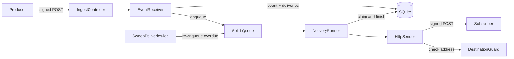
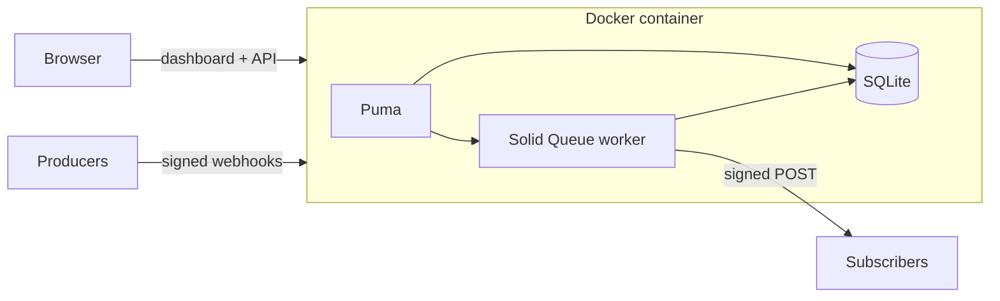

# Hookline

[](https://github.com/sufian07/hookline/actions/workflows/ci.yml)

A small webhook gateway built with Rails 8. It receives signed webhooks, stores each one once, and delivers them to subscribers with retries.

**Live demo:** [hookline-twph.onrender.com](https://hookline-twph.onrender.com/). Sign in with the read-only token `demo-viewer`. It runs on Render's free plan, so the first visit after a quiet spell takes about a minute, and the data resets whenever it restarts.

## What works

- **Ingest:** `POST /in/:token` with HMAC-SHA256 verification, a 5-minute replay window, a size limit and idempotency keys
- **Fan-out:** one delivery per active subscription, with an optional event-type filter
- **Delivery:** signed outgoing requests, exponential backoff with jitter, dead-letter after 8 attempts, every completed attempt recorded
- **Recovery:** delivery rows are the source of truth; a sweep repairs lost jobs and dead workers
- **Destination safety:** https only, private and reserved addresses blocked, connection pinned to the checked address, redirects not followed
- **Management API:** sources, subscriptions, events and deliveries, with cursor pagination
- **Replay:** re-queue a dead or delivered delivery with a fresh set of attempts
- **Access:** an admin token for everything, and an optional read-only viewer token
- **Rate limits:** per source token on ingest, per API token on the API
- **Dashboard:** React and TypeScript, served by Rails at `/dashboard/`. Browse events and their attempts, find dead deliveries and replay them, create sources and subscriptions, and pause or resume subscriptions. Viewers see everything but cannot change it.

Delivery is at least once. Receivers should de-duplicate on `X-Hookline-Delivery`.

Not built: user accounts, an audit log, and multi-instance deployment (see [ADR 1](docs/adr/0001-sqlite-and-solid-queue.md)).

## Flow



## Run

```sh
bundle install
bin/rails db:prepare
bundle exec rspec
HOOKLINE_ADMIN_TOKEN=change-me bin/rails server
bin/jobs   # workers; needs fork, so Linux or macOS
```

## Dashboard

```sh
cd frontend
npm ci
npm test          # Vitest and Testing Library
npm run build     # type-checks, then builds into public/dashboard
```

Then open `http://localhost:3000/` and sign in with a token. The token is kept in session storage, so it lasts for the browser tab only. For live reload, run `npm run dev` next to the Rails server; Vite proxies `/api` to port 3000.

## Configuration

| Variable | Purpose |
|---|---|
| `HOOKLINE_ADMIN_TOKEN` | Full API access. Without it, nobody has write access. |
| `HOOKLINE_VIEWER_TOKEN` | Optional read-only access. Writes return 403. |
| `HOOKLINE_DEMO_MODE=1` | Loads demo data into an empty database, sends a demo event every 5 minutes, and only allows subscriptions to the built-in demo receiver. |
| `APP_URL` | Public base URL, used to build the demo receiver's address. On Render, `RENDER_EXTERNAL_URL` is used instead. |
| `HOOKLINE_INGEST_PER_MINUTE`, `HOOKLINE_API_PER_MINUTE` | Rate limits; defaults 120 and 300. |
| `SECRET_KEY_BASE`, `ENCRYPTION_*` | Required in production; the app will not start without them. |

## Deployment

One Docker image runs the API, the dashboard and the Solid Queue worker (inside Puma), with SQLite on local disk.



`render.yaml` deploys the public demo on Render's free plan, after CI passes on `main`. To use it, choose **New, Blueprint** in Render, select this repository, and set `HOOKLINE_ADMIN_TOKEN` when asked.

Free-plan limits:

- **Sleeps when idle:** after 15 minutes without traffic. The first request after that takes about a minute.
- **No persistent disk:** every restart or wake-up starts again from fresh demo data.
- **Retries pause while asleep:** the sweep catches up when the service wakes.

The demo's viewer token is `demo-viewer`. It is public on purpose and read-only. In demo mode, subscriptions can only point at the built-in receiver, which fails about a third of requests so retries and dead letters are visible.

## Performance

Measured in CI against the Docker image on a GitHub-hosted runner, sending signed ingest requests over 8 keep-alive connections:

| Measure | Value |
|---|---|
| Requests | 3,000 |
| Throughput | 503 requests/s |
| Latency p50 / p95 / p99 | 12.1 / 18.0 / 66.6 ms |
| Errors | 0 |

The load-test source had no subscriptions, so this measures verification, idempotency and storage, not fan-out. Each CI run repeats the test and shows its numbers in the job summary. Run it yourself with `ruby script/load_test.rb BASE_URL ADMIN_TOKEN [REQUESTS] [CONCURRENCY]`.

## CI

Every push runs:

- Rails specs, RuboCop, Brakeman and a gem audit
- Dashboard type check, tests and build
- `script/worker_smoke.sh`: starts the server and the Solid Queue worker, sends a signed webhook, and waits for the worker to record a delivery attempt
- The Docker image: refuses to start without secrets, delivers through its own worker, serves demo data read-only to the viewer token, and runs the load test

## API

Every `/api` request needs `Authorization: Bearer <token>`. `GET /api/session` returns the token's role.

| Method | Path | Notes |
|---|---|---|
| `POST` | `/api/sources` | `name`, `signing_secret`. Returns the ingest token once. |
| `GET` | `/api/sources`, `/api/sources/:id` | |
| `POST` | `/api/sources/:id/subscriptions` | `url`, optional `event_filter`. Returns the signing secret once. |
| `GET` | `/api/sources/:id/subscriptions` | |
| `PATCH` | `/api/subscriptions/:id` | `url`, `event_filter`, `active` |
| `GET` | `/api/events` | Filters: `source_id`, `event_type` |
| `GET` | `/api/events/:id` | Payload, deliveries and every attempt |
| `GET` | `/api/deliveries` | Filters: `status`, `subscription_id` |
| `POST` | `/api/deliveries/:id/replay` | Only for `dead` or `delivered`; otherwise 409 |

Writes need the admin token. Lists return `{ "data": [...], "next_cursor": ... }`, newest first. Pass `before=<next_cursor>` for the next page and `limit` (up to 100) to change the page size.

```sh
curl -H "Authorization: Bearer $HOOKLINE_ADMIN_TOKEN" -H "Content-Type: application/json" \
  -d '{"name":"Shop","signing_secret":"change-me"}' localhost:3000/api/sources
```

## Request signature

`X-Hookline-Signature` is `sha256=` followed by the hex HMAC-SHA256 of `"<timestamp>.<raw body>"`. Ingest also requires `X-Hookline-Timestamp`, `X-Hookline-Event` and `X-Hookline-Idempotency-Key`. Outgoing requests use the same scheme with the subscription's secret.

## Decisions

See [docs/adr](docs/adr).
