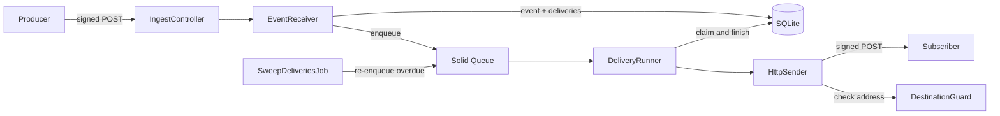

# Hookline

A small webhook gateway built with Rails 8. It receives signed webhooks, stores each one once, and delivers them to subscribers with retries.

## What works

- **Ingest:** `POST /in/:token` with HMAC-SHA256 verification, a 5-minute replay window, a size limit and idempotency keys
- **Fan-out:** one delivery per active subscription, with an optional event-type filter
- **Delivery:** signed outgoing requests, exponential backoff with jitter, dead-letter after 8 attempts, every completed attempt recorded
- **Recovery:** delivery rows are the source of truth; a sweep repairs lost jobs and dead workers
- **Destination safety:** https only, private and reserved addresses blocked, connection pinned to the checked address, redirects not followed
- **Management API:** sources, subscriptions, events and deliveries, with bearer-token auth and cursor pagination
- **Replay:** re-queue a dead or delivered delivery with a fresh set of attempts
- **Dashboard:** React and TypeScript, served by Rails at `/dashboard/`. Browse events and their attempts, find dead deliveries and replay them, create sources and subscriptions, and pause or resume subscriptions.

Delivery is at least once. Receivers should de-duplicate on `X-Hookline-Delivery`.

## Not built yet

CI and deployment. Access is a single admin token, with no user accounts or audit log.

## Flow



## Run

```sh
bundle install
bin/rails db:prepare
bundle exec rspec
HOOKLINE_ADMIN_TOKEN=change-me bin/rails server
bin/jobs   # workers; needs fork, so Linux or macOS
```

## Dashboard

```sh
cd frontend
npm ci
npm test          # Vitest and Testing Library
npm run build     # type-checks, then builds into public/dashboard
```

Then open `http://localhost:3000/` and sign in with the admin token. The token is kept in session storage, so it lasts for the browser tab only. For live reload, run `npm run dev` next to the Rails server; Vite proxies `/api` to port 3000.

## API

Every `/api` request needs `Authorization: Bearer $HOOKLINE_ADMIN_TOKEN`. Without that variable, the API refuses all requests.

| Method | Path | Notes |
|---|---|---|
| `POST` | `/api/sources` | `name`, `signing_secret`. Returns the ingest token once. |
| `GET` | `/api/sources`, `/api/sources/:id` | |
| `POST` | `/api/sources/:id/subscriptions` | `url`, optional `event_filter`. Returns the signing secret once. |
| `GET` | `/api/sources/:id/subscriptions` | |
| `PATCH` | `/api/subscriptions/:id` | `url`, `event_filter`, `active` |
| `GET` | `/api/events` | Filters: `source_id`, `event_type` |
| `GET` | `/api/events/:id` | Payload, deliveries and every attempt |
| `GET` | `/api/deliveries` | Filters: `status`, `subscription_id` |
| `POST` | `/api/deliveries/:id/replay` | Only for `dead` or `delivered`; otherwise 409 |

Lists return `{ "data": [...], "next_cursor": ... }`, newest first. Pass `before=<next_cursor>` for the next page and `limit` (up to 100) to change the page size.

```sh
curl -H "Authorization: Bearer $HOOKLINE_ADMIN_TOKEN" -H "Content-Type: application/json" \
  -d '{"name":"Shop","signing_secret":"change-me"}' localhost:3000/api/sources
```

## Request signature

`X-Hookline-Signature` is `sha256=` followed by the hex HMAC-SHA256 of `"<timestamp>.<raw body>"`. Ingest also requires `X-Hookline-Timestamp`, `X-Hookline-Event` and `X-Hookline-Idempotency-Key`. Outgoing requests use the same scheme with the subscription's secret.

## Decisions

See [docs/adr](docs/adr).
