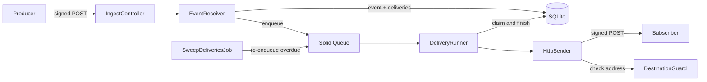

# Hookline

A small webhook gateway built with Rails 8. It receives signed webhooks, stores each one once, and delivers them to subscribers with retries.

## What works

- **Ingest:** `POST /in/:token` with HMAC-SHA256 verification, a 5-minute replay window, a size limit and idempotency keys
- **Fan-out:** one delivery per active subscription, with an optional event-type filter
- **Delivery:** signed outgoing requests, exponential backoff with jitter, dead-letter after 8 attempts, every completed attempt recorded
- **Recovery:** delivery rows are the source of truth; a sweep repairs lost jobs and dead workers
- **Destination safety:** https only, private and reserved addresses blocked, connection pinned to the checked address, redirects not followed

Delivery is at least once. Receivers should de-duplicate on `X-Hookline-Delivery`.

## Not built yet

Management API, React dashboard, replay, CI and deployment. Until the API exists, create sources and subscriptions in the Rails console.

## Flow



## Run

```sh
bundle install
bin/rails db:prepare
bundle exec rspec
bin/rails server
bin/jobs   # workers; needs fork, so Linux or macOS
```

In the console:

```ruby
source = Source.create!(name: "Shop", signing_secret: "change-me")
source.token # shown once
source.subscriptions.create!(url: "https://receiver.example.com/hooks")
```

## Request signature

`X-Hookline-Signature` is `sha256=` followed by the hex HMAC-SHA256 of `"<timestamp>.<raw body>"`. Ingest also requires `X-Hookline-Timestamp`, `X-Hookline-Event` and `X-Hookline-Idempotency-Key`. Outgoing requests use the same scheme with the subscription's secret.

## Decisions

See [docs/adr](docs/adr).
